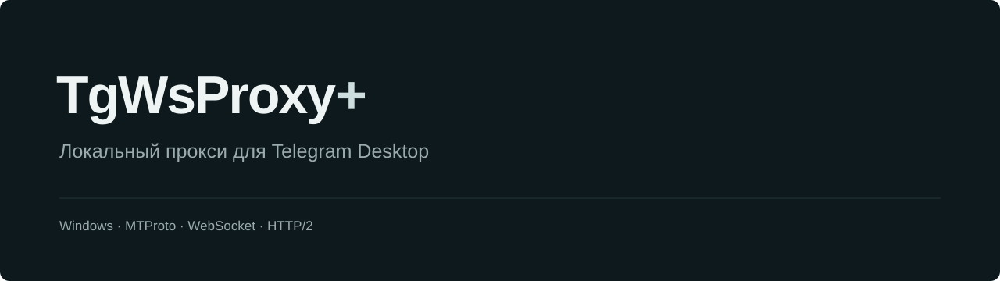
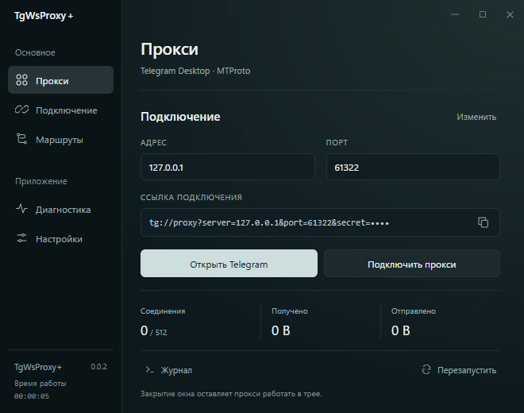

<p align="center">
  
</p>

<p align="center">
  
  
  <a href="LICENSE"></a>
</p>

<p align="center">
  <a href="#первый-запуск">Начать</a> ·
  <a href="#сборка">Собрать</a> ·
  <a href="docs/architecture.md">Как устроено</a> ·
  <a href="CONTRIBUTING.md">Помочь проекту</a>
</p>

TgWsProxy+ — небольшой локальный прокси для Telegram Desktop. Он принимает MTProto-соединения на твоём компьютере и передаёт их через WebSocket или резервные маршруты, когда обычный путь недоступен.

Включил прокси один раз — дальше приложение остаётся в трее. Один клик по значку открывает Telegram, правый клик — меню приложения.

> **Переход с 0.2.x:** скачай 0.0.2 вручную, закрой прежний экземпляр через меню трея и замени EXE. Нумерация начинается заново, поэтому старое приложение не предложит эту версию автоматически. Настройки сохранятся.

<p align="center"></p>

## Что внутри

- Rust-ядро и интерфейс на Astro + Preact через установленный в Windows WebView2. Браузерный движок не входит в EXE.
- Спокойные светлая и тёмная темы, русский и английский языки, поддержка системного масштаба.
- Статистика трафика, наблюдаемые маршруты, проверка соединений и журнал.
- MTProto abridged, intermediate и padded intermediate, Fake TLS и PROXY protocol v1.
- Telegram WebSocket, Cloudflare WebSocket и HTTP/2, собственный Worker и резервный TCP.
- Настройки пула и HTTP/2; консольный режим для Windows, Linux и macOS.

Локальная x64-сборка с интерфейсом занимает около **1,4 МиБ**. Точный размер и условия измерения — в [отчёте о версии 0.0.2](docs/ui-0.0.2.md). Файлы установленного WebView2 Runtime и его память в это число не входят.

## Первый запуск

Нужны Windows 10/11 и [Microsoft Edge WebView2 Runtime](https://developer.microsoft.com/microsoft-edge/webview2/). Если Runtime уже установлен, скачивать его повторно не потребуется.

1. Скачай [Windows x64 EXE](https://github.com/T1REI/TgWsProxyPlus/releases/latest/download/TgWsProxyPlus-windows-x86_64.exe) и запусти его. Все сборки — на [странице релизов](https://github.com/T1REI/TgWsProxyPlus/releases/latest).
2. В разделе «Прокси» нажми **Подключить прокси** и подтверди добавление в Telegram.
3. Закрой окно приложения — прокси продолжит работать в трее.

По умолчанию используется `127.0.0.1:1443`. Секрет создаётся при первом запуске и сохраняется в конфигурации. После смены адреса, порта или секрета добавь прокси в Telegram заново.

**ЛКМ по трею** открывает Telegram. **ПКМ → Открыть TgWsProxy+** показывает интерфейс. Для полного завершения выбери **Выход**. Повторный запуск EXE открывает окно уже работающего экземпляра.

Если локальный сервер не может запуститься, приложение покажет сообщение с причиной. Доступность удалённых маршрутов проверяется отдельно в разделе «Диагностика».

## Настройки и переносной режим

Конфигурация и журнал находятся в `%APPDATA%\TgWsProxyPlus`. Профиль WebView2 хранится рядом в подкаталоге `WebView2`.

Для переносного режима создай рядом с EXE пустой файл `TgWsProxyPlus.portable` или запусти программу с `--portable`. Данные будут в `TgWsProxyPlus-data` рядом с приложением.

Проверка обновлений включена по умолчанию: при запуске и каждые шесть часов. Её можно отключить в настройках.

Смена темы, языка, автозапуска и параметров журнала не разрывает соединения. Изменение сетевых параметров перезапускает прокси. Несохранённые поля остаются в окне, пока ты не сохранишь или не отменишь изменения.

## Сборка

Для Windows нужны Rust **1.96**, MSVC Build Tools и Node.js **24.16** или совместимая версия.

```sh
npm ci --prefix ui
npm run build --prefix ui
cargo build --release --locked
```

Результат: `target/release/TgWsProxyPlus.exe`. HTML, CSS и JS встроены в этот файл; Node.js на компьютере пользователя не нужен. `scripts/package.ps1` собирает локальный ZIP с документацией и лицензиями и ничего не публикует.

Для разработки интерфейса: `npm run dev --prefix ui`. В браузере открывается явно обозначенный предпросмотр без подключения к Rust-ядру.

Консольная сборка не требует фронтенда или WebView2:

```sh
cargo build --release --locked --no-default-features
```

```sh
TgWsProxyPlus --console
TgWsProxyPlus --diagnose
TgWsProxyPlus --help
```

Параметры командной строки действуют только для текущего запуска. Свой JSON можно создать через `--init-config path/to/config.json` и использовать через `--config path/to/config.json`.

## Что стоит знать

Приложение не является VPN. Оно не перенаправляет весь трафик компьютера и не обеспечивает голосовые или видеозвонки Telegram. Доступность резервных маршрутов зависит от сети и удалённых серверов.

Основной процесс прокси компактный, но открытое окно WebView2 использует отдельные процессы и дополнительную память. Окно создаётся только по запросу; обычный запуск в трее не загружает WebView2.

## Документация

[Архитектура](docs/architecture.md) · [Измерения 0.0.2](docs/ui-0.0.2.md) · [Сетевые измерения](docs/performance.md) · [Сверка с upstream](docs/upstream-audit.md) · [Тесты](tests/README.md)

Нашёл ошибку или есть идея — [открой issue](https://github.com/T1REI/TgWsProxyPlus/issues). Как собрать проект и подготовить изменение, описано в [CONTRIBUTING.md](CONTRIBUTING.md).

## Авторы и лицензия

Rust-версию и приложение развивает **T1REI**. Основа — [tg-ws-proxy от Flowseal](https://github.com/Flowseal/tg-ws-proxy).

Код распространяется под MIT: [лицензия проекта](LICENSE), [лицензия upstream](LICENSE.upstream). Уведомления о сторонних компонентах находятся в [THIRD_PARTY_NOTICES.txt](THIRD_PARTY_NOTICES.txt).
