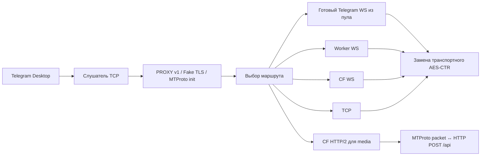

# Архитектура TgWsProxyPlus

Приложение — один Rust crate с библиотекой для тестирования ядра и исполняемым файлом. На Windows feature `desktop` включает Win32-трей и лениво создаваемый интерфейс WebView2; сетевое ядро от неё не зависит. В трее работает отдельный поток Tokio с одним исполнителем; основной поток обслуживает Windows message loop. Остановка через oneshot завершает клиентов и фоновые задачи до запуска нового слушателя.

`crypto` проверяет 64-байтовый MTProto init, выводит ключи SHA-256 с секретом локального прокси и создаёт новый стандартный obfuscation init без этого секрета для Telegram. Порядок байтов CTR проверяется векторами NIST и исходной Python-реализации. Содержимое MTProto сессии приложение не расшифровывает: внутренняя защита Telegram остаётся сквозной.

`framing` выделяет пакеты и учитывает quick-ack bit. Для WS сохраняются зашифрованные границы транспортных пакетов. Нулевая длина переводит WS splitter в режим passthrough, как в upstream. HTTP/2 допускает только валидные MTProto packets; padded transport очищается от внешнего padding перед POST и восстанавливается на ответе.

`network` использует системный TLS, TCP keepalive и TCP_NODELAY. Fronting сохраняет проверку цепочки сертификата, меняя SNI на `sprinthost.ru` и разрешая несовпадение имени. Это воспроизводит специальный маршрут upstream. Обычные HTTPS/WS/H2 соединения проверяют цепочку и имя. `--no-secure` отключает TLS для CF/Worker и исключает H2.

`pool` управляет TTL 100 секунд, прогревом, cooldown и предпочтением успешного способа fronting. Начальный прогрев — одно соединение на группу; обращения увеличивают цель до pool_size и будят обслуживание через Notify. Готовые сокеты публикуются по одному без ожидания остальных. Одновременно работают не более четырёх фоновых подключений. Через 30 секунд простоя цель уменьшается до одного соединения, через 120 секунд — до нуля. Период обслуживания — 15 секунд. Нулевой pool_size отключает прямые WS.

`performance` хранит до 128 записей по DC, типу трафика и маршруту. Рейтинг учитывает сглаженные задержки подключения и первого ответа, скорость активных передач медиа, ошибки и число сессий. Паузы между порциями больше секунды исключаются из оценки скорости. Счётчики шифрованного трафика обновляются примерно раз в секунду при активности и при закрытии сессии. История существует только в памяти.

`routing` ранжирует туннели и пробует максимум два одновременно с задержкой 200 мс. Ошибка немедленно запускает следующего кандидата; проигравшие попытки отменяются. Трафик клиента отправляется только победителю. Не более восьми handshake одновременно на приложение; таймаут попытки — 8 секунд, всего выбора — 16 секунд. Неудачный маршрут получает cooldown 2–60 секунд. Каждое шестнадцатое подключение проверяет альтернативу. Обычный TCP пробуется после отказа туннелей: принятие TCP-сокета ещё не доказывает доступность MTProto. После ошибки активного канала сессия завершается, новый маршрут выбирается при переподключении клиента.

`h2_pool` держит 1–3 lane на сервер (по умолчанию максимум 2). Расширение происходит при занятых сессиях, новые сессии выбирают lane по числу сессий, затем запросов. Счётчик сессий освобождается через RAII, включая отмену. Неудачное расширение сохраняет рабочую lane с паузой 30 секунд. Простой без новых обращений 60 секунд позволяет закрыть неиспользуемые lane; обслуживание выполняется каждые 30 секунд.

`h2_transport` предоставляет настоящее мультиплексированное H2 через ALPN. Для одной lane ограничены 64 запроса; все lane маршрутизатора разделяют бюджет 32 МиБ резервируемых тел запросов/ответов. Разрешение памяти удерживается до обработки ответа. Бюджет не включает все очереди протокола, TLS и буферы клиентов. Окна по умолчанию — 1 МиБ на поток и 4 МиБ на соединение; значения валидируются в конфигурации. Буфер ответа заранее выделяется по допустимому Content-Length. Учитывается уже выделенная H2 send capacity, затем ожидается новое окно. Таймаут запроса 65 секунд. Заголовки ограничены 32 КиБ, push отключён.

`h2_channel` обслуживает максимум 8 запросов клиента; очередь входа — 2 пакета. История повторов хранит только внутренне зашифрованные MTProto packets: до 16 штук, суммарно 64 КиБ, срок 30 секунд. Незашифрованный auth_key_id=0 не повторяется. Одновременно допускаются 2 повтора, до 3 попыток для записи истории. Новые пакеты и ожидающие разрешения памяти запросы имеют приоритет перед повторами. Запрос с уже полученными заголовками/частью тела не отменяется ради повтора. HTTP 403/404/429/444 и отрицательные MTProto transport errors передаются клиенту в его транспортном шифровании.

Ограничение MTProto-пакета — 4 МиБ с дополнительными 256 байтами внешнего padding. WS splitter хранит только открытый заголовок до четырёх байт и зашифрованный пакет; полной копии открытого пакета нет. Буферы пересылки TCP/WS — 32 КиБ, временный WS-буфер используется повторно. Максимум клиентов по умолчанию — 512; buf_kb=0 оставляет размеры сокетов и автонастройку ОС. Старые явные значения сохраняются. Пулы, активные TLS-соединения и H2-пакеты увеличивают память по нагрузке; для экономии можно уменьшить pool_size и h2_max_connections.

`fake_tls` проверяет HMAC, окно времени ±120 секунд и replay cache. AsyncRead/Write сохраняет частичные записи/чтения TLS records при backpressure и отмене будущего. `server` ограничивает одновременные подключения, handshake timeout и владение задачами.

`config` сохраняет неизвестные upstream JSON-ключи, валидирует значения и заменяет файл через временный файл в том же каталоге. В Unix права нового конфига — 0600. `logging` ограничивает количество архивов и размер файла; секрет не журналируется, пользовательские домены маскируются. CLI-команда `--link` намеренно выводит секрет в ссылке подключения.

`windows` обслуживает Win32-трей, clipboard, HKCU Run и оконный цикл. `windows/webview` создаёт системный WebView2 только при открытии окна. Статическая сборка Astro + Preact встраивается через `build.rs`; ресурсы выдаются из памяти на `https://tgws.local` через WebResourceRequested. Локальный HTTP-сервер, Node.js, Tauri и встроенный Chromium не используются. Удалённая навигация, новые окна и разрешения WebView запрещены. Сообщения принимаются только с локальной страницы, ограничены по размеру и проходят разбор команд на стороне Rust.

Прокси запускается раньше интерфейса. Метрики публикуются раз в секунду, когда окно видно. Маршруты передаются типизированным снимком из `performance`, без разбора строк журнала. Счётчики показывают текущий сеанс; готовность слушателя не означает доступность Telegram.

`windows/settings` валидирует конфигурацию и определяет необходимость перезапуска ядра. Тема, язык, автозапуск и журнал не меняют сетевой поток. Неизвестные сохранённые JSON-поля сохраняются. Окно поддерживает Per-Monitor V2 DPI, изменение размера и скрытие в трей с несохранёнными полями.

`windows/telegram` сначала ищет окно уже запущенного Telegram по имени исполняемого файла и выводит его на передний план. Иначе использует проверенный абсолютный путь Telegram.exe из регистрации протокола или обычной установки. Зарегистрированный каталог профиля `-workdir` сохраняется; остальные аргументы из реестра не передаются; для неизвестной установки остаётся обработчик `tg://`. Повторное нажатие в пределах 400 мс не запускает второе открытие. Подключение прокси через `tg://proxy` — отдельное действие.

## Обновления

`updates` обращается к фиксированному GitHub API репозитория `T1REI/TgWsProxyPlus`. Сравнение версий — SemVer; draft и prerelease исключены. URL страницы и бинарника должны точно соответствовать репозиторию, тегу и платформе. Скачивание допускает HTTPS GitHub/GitHubusercontent, не более 5 redirect и 16 МиБ. Размер и SHA-256 asset.digest обязательны. Это проверка целостности относительно GitHub-метаданных, отдельной криптографической подписи издателя пока нет.

`update_http` сначала пробует HTTP/2 с таймаутом 20 секунд, затем HTTP/1.1 с таймаутом 40 секунд. Оба пути проверяют системную цепочку сертификата и имя сервера. HTTP/1.1 поддерживает Content-Length, chunked и закрытие соединения; ограничивает заголовки и тело, отвергает неоднозначное framing и сжатие. Сетевые ошибки и HTTP 5xx повторяются до трёх попыток с паузами 1 и 2 секунды. Проверка версии ограничена 180 секундами, загрузка — 240 секундами. HTTP 403/429 возвращается как ограничение GitHub без немедленных повторов.

Имена бинарных файлов релизов: `TgWsProxyPlus-windows-x86_64.exe`, `TgWsProxyPlus-windows-aarch64.exe`, `TgWsProxyPlus-linux-x86_64`, `TgWsProxyPlus-macos-x86_64`, `TgWsProxyPlus-macos-aarch64`. CI проверяет сборки для этих платформ. Готовые файлы публикуются в GitHub Releases. В обычной сборке проверка при запуске и таймер раз в 6 часов управляются `check_updates`; одновременные проверки и загрузки исключены. Автоматические ошибки остаются в журнале. В Linux/macOS доступна CLI-проверка новой версии, установка предусмотрена Windows-оболочкой.

`update_install` сохраняет JSON-план рядом с текущим EXE и запускает его копию с `--apply-update`. Основной процесс завершает прокси и освобождает mutex. Вспомогательный процесс ждёт его завершения до 60 секунд, повторно проверяет SHA-256, PE64, архитектуру и запуск `--version` с лимитом 5 секунд. Затем переименовывает старый EXE в уникальный `.backup.exe`, устанавливает загруженный файл и запускает его с исходным конфигом и `--update-ready`. Новый GUI подтверждает nonce только после события готовности TCP-слушателя. Вспомогательный процесс ждёт подтверждения до 30 секунд и проверяет, что запущенный процесс остался жив. При отказе он завершает только этот дочерний процесс, восстанавливает прежний EXE и перезапускает его. После успеха новый GUI удаляет вспомогательные файлы, дождавшись завершения установщика. Backup сохраняется для ручного восстановления. Это откат при обработанных ошибках установки и запуска; сохранность при внезапном отключении питания отдельно не гарантируется.

Закрытие окна перехватывает WM_CLOSE и WM_SYSCOMMAND/SC_CLOSE до заимствования состояния UI. Это предотвращает повторный вход в DefWindowProc с уже занятым RefCell и уничтожение окна. Несохранённые поля остаются в интерфейсе, прокси продолжает работать; завершение остаётся в пункте «Выход» меню трея.

Обычные сборки используют `TGWS_REVIEW_BUILD=0` и поддерживают обновления. Для изолированной разработки можно включить `TGWS_REVIEW_BUILD=1`. Переход с прежней 0.2.x на 0.0.2 выполняется вручную: более низкий номер не предлагается старым клиентом как обновление.
